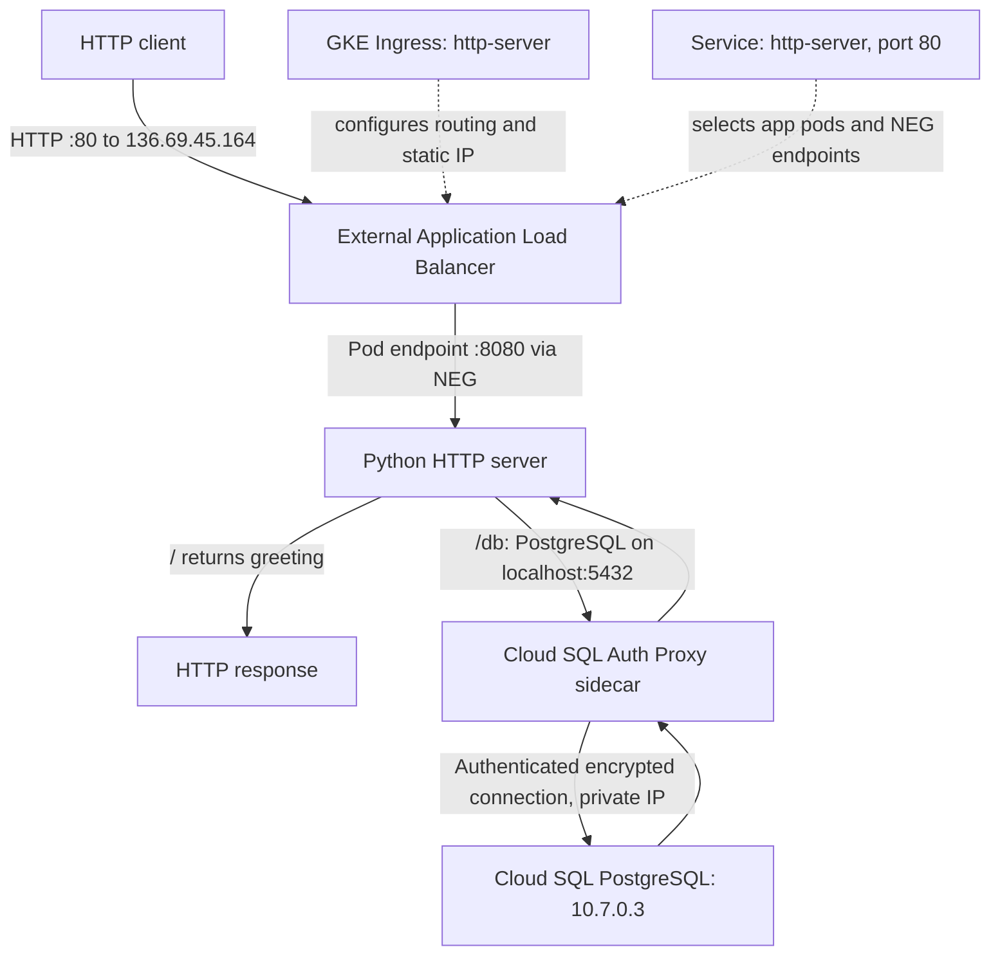
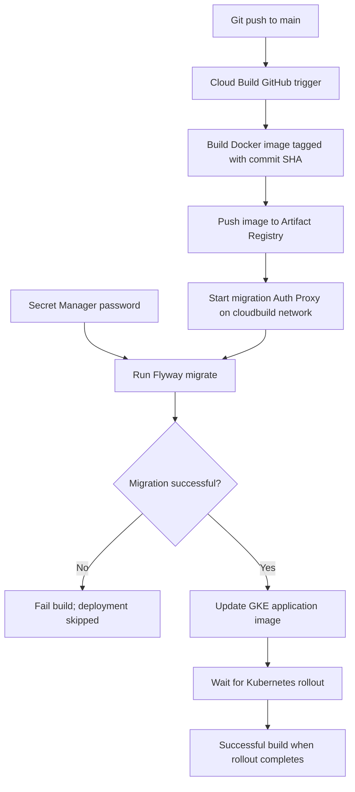
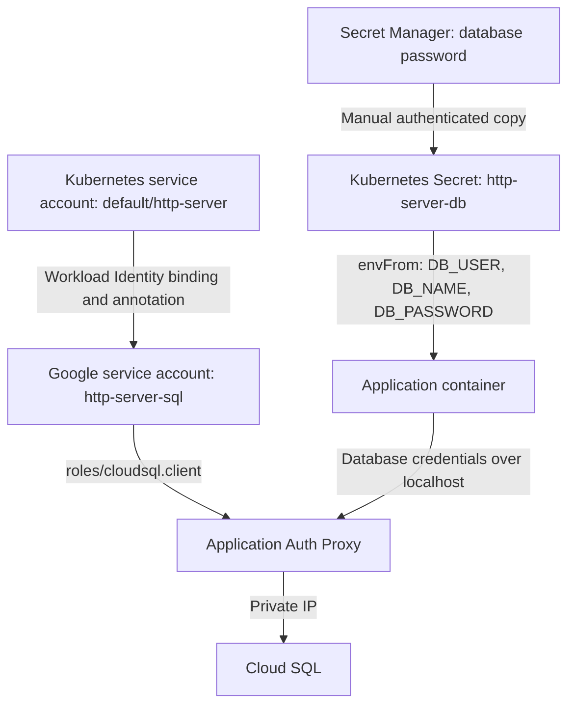
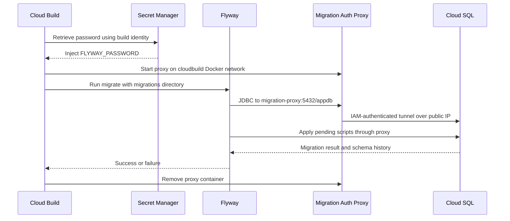

# GCP Application Delivery Lab

**Author:** Kazimir Shklennik  
**Date:** 31 October 2026  
**Project:** `cloudx-task-513315`  
**Region:** `europe-west1`  
**Source:** https://github.com/kshklennik/gcp-http-server

## 1. Overview

This lab implements a containerized Python HTTP application on Google Kubernetes Engine (GKE). GitHub stores the source code, Cloud Build builds Docker images and deploys them, Artifact Registry stores the images, and a GKE Ingress exposes the application through an external Application Load Balancer with a reserved static IP.

The application connects to Cloud SQL for PostgreSQL through a Cloud SQL Auth Proxy sidecar using private IP. A separate proxy in Cloud Build uses public IP for Flyway database migrations. Database credentials are stored in Secret Manager and copied into a Kubernetes Secret for the application.

**Source repository deviation:** Cloud Source Repositories could not be enabled for this new trial project. GitHub was used instead. Acceptance of this substitution remains subject to the course assessor.

**Evidence scope:** Resource names and configuration below reflect the lab session. HTTP 200 through the load balancer and the Cloud SQL private IP were directly shown in command output. Later pipeline and migration steps were reported completed; attach their actual successful build logs to the submission. This report does not constitute an independent live audit.

## 2. Resources

| Resource | Configuration |
|---|---|
| Git repository | `kshklennik/gcp-http-server`, branch `main` |
| Artifact Registry | `europe-west1-docker.pkg.dev/cloudx-task-513315/docker-repo` |
| Application image | `http-server`, tagged with Git commit SHA |
| GKE | Autopilot cluster `http-server-cluster` |
| Network / subnet | `default` / `default` |
| Namespace | `default` |
| Deployment / Service / Ingress | `http-server` |
| Application port | TCP 8080 |
| Service port | TCP 80, targeting 8080 |
| Reserved global IP | `http-server-ip`: `136.69.45.164` |
| Cloud SQL | `http-server-db`, PostgreSQL 16, Enterprise, `db-f1-micro` |
| SQL connection name | `cloudx-task-513315:europe-west1:http-server-db` |
| SQL private IP | `10.7.0.3` |
| SQL public IP | `34.156.62.104` |
| Database / user | `appdb` / `appuser` |
| Secret Manager secret | `http-server-db-password` |
| Kubernetes Secret | `http-server-db` |

## 3. Request flow



The Service uses the `app: http-server` selector and an Ingress NEG annotation. With container-native load balancing, the load balancer targets pod endpoints; the Service defines backend selection rather than acting as a separate network hop.

The Ingress references `http-server-ip` through `kubernetes.io/ingress.global-static-ip-name` and uses the `gce` controller annotation. No custom domain or HTTPS certificate was configured in this lab.

For `/db`, the app authenticates to PostgreSQL as `appuser` and executes `SELECT current_database()`. The sidecar uses `--private-ip`, so application database traffic continues to use the private address even after public IP is enabled for migrations.

## 4. Manual Docker build and deployment

A Python HTTP server was created in `app.py`, listening on `0.0.0.0:8080`. A Dockerfile based on `python:3.13-slim` packages the application. PostgreSQL support was subsequently added through `psycopg[binary]` in `requirements.txt`.

The initial image was built and tested locally:

```bash
docker build -t http-server:v1 .
docker run -d --name http-server -p 8080:8080 http-server:v1
curl -i http://localhost:8080
```

Docker authentication was configured for `europe-west1-docker.pkg.dev`. The image was tagged and pushed to Artifact Registry. A Kubernetes Deployment was then created using an image built by Cloud Build. A subsequent image was deployed with `kubectl set image`, and `kubectl rollout status` verified rollout completion. Port forwarding was used to test the application before external exposure.

## 5. CI/CD flow



The GitHub repository is connected through the Cloud Build GitHub App. Trigger `build-http-server` listens for pushes matching `^main$` and uses the repository's `cloudbuild.yaml`.

The pipeline explicitly pushes the image before migration and deployment. After successful migrations, `kubectl set image` updates the existing Deployment, and `kubectl rollout status --timeout=300s` waits for completion. The application sidecar, service account, and secret references remain in the pod template during image updates.

**Current automation boundary:** the pipeline updates the application image; it does not run `kubectl apply -f deployment.yaml` or `ingress.yaml`. Those infrastructure manifests were applied manually and committed for reference. Applying `deployment.yaml` later can restore its recorded image tag; update that tag before using it.

Cloud Build logs use `CLOUD_LOGGING_ONLY`. Builds run as `cloud-build-runner@cloudx-task-513315.iam.gserviceaccount.com`.

## 6. Private Cloud SQL connectivity and identity

Private services access was configured on the `default` VPC using an automatically selected `/16` allocation named `google-managed-services-default` and a peering connection to `servicenetworking.googleapis.com`.

The Cloud SQL instance was initially created without a public IP. Its final private address is `10.7.0.3`. A public IP was subsequently added specifically for the migration requirement.

The Deployment runs two containers: `http-server` and `cloud-sql-proxy`. The proxy image is `gcr.io/cloud-sql-connectors/cloud-sql-proxy:2.18.2`, with `--private-ip`, `--port=5432`, and the SQL connection name.



The GKE workload pool is `cloudx-task-513315.svc.id.goog`. The Kubernetes service account is linked to `http-server-sql@cloudx-task-513315.iam.gserviceaccount.com` using `roles/iam.workloadIdentityUser`. No downloaded service account key is needed.

The proxy's IAM identity authorizes the connection; the app's database username and password authenticate the PostgreSQL session. These are separate authentication layers.

## 7. Secrets and permissions

| Identity or secret | Purpose |
|---|---|
| Build account: Artifact Registry Writer on `docker-repo` | Push images |
| Build account: Logs Writer | Write build logs |
| Build account: Kubernetes Engine Developer | Update deployment and inspect rollout |
| Build account: Cloud SQL Client | Authenticate migration proxy |
| Build account: Secret Accessor on `http-server-db-password` | Retrieve migration password |
| App Google service account: Cloud SQL Client | Authenticate private-IP sidecar |
| `http-server-db-password` | Password stored in Secret Manager |
| `http-server-db` | Kubernetes keys `DB_USER`, `DB_NAME`, `DB_PASSWORD` |

The password was entered through a hidden terminal prompt, stored in Secret Manager, and streamed into the Kubernetes Secret without committing its value. Kubernetes Secret values are base64-encoded, so access must still be controlled through Kubernetes permissions.

The Secret Manager-to-Kubernetes copy is manual, not continuous synchronization. Password rotation requires updating Cloud SQL, Secret Manager, and the Kubernetes Secret, then restarting application pods to reload environment variables. Cloud Build reads the latest Secret Manager version on each build.

## 8. Automated Flyway migrations over public IP



The migration proxy omits `--private-ip`, selecting the public-IP connection. No authorized network was added for direct PostgreSQL access. Flyway reaches the proxy on the build's Docker network; the proxy encrypts the connection to Cloud SQL.

The migration step mounts `/workspace/migrations` read-only at `/flyway/sql` and uses `redgate/flyway:10.20.1`. It connects as `appuser`, retries initial connections, and runs `migrate`. A shell exit trap removes the proxy on success or failure.

| Script | Change |
|---|---|
| `V1__create_messages.sql` | Create `messages` with identity primary key, content, timestamp; insert initial row |
| `V2__add_message.sql` | Insert a row demonstrating automatic application of a new migration |

Flyway records completed versions in `flyway_schema_history`. Subsequent builds validate existing migrations and apply pending versions. Applied scripts should remain unchanged; new changes belong in new versioned files. Migration failure blocks deployment, but a later deployment failure does not automatically undo a successful database migration.

## 9. Verification and submission evidence

The recorded Ingress output showed the backend as `HEALTHY`, a pod endpoint on port 8080, and address `136.69.45.164`. The initial Google frontend 404 responses were followed by HTTP 200 with `Via: 1.1 google`; the application logs recorded the successful request. This is consistent with initial load-balancer propagation.

Cloud SQL command output showed `RUNNABLE`, private IP `10.7.0.3`, and subsequently public IP `34.156.62.104`. The initial SQL creation command returned an internal error while its backend operation remained running; checking that operation avoided creating a duplicate instance.

Run these checks and capture their output for the final submission:

```bash
kubectl get deployment,pods,service,ingress
curl -i http://136.69.45.164/
curl -i http://136.69.45.164/db
kubectl logs deployment/http-server -c cloud-sql-proxy --tail=20
gcloud sql instances describe http-server-db \
  --project=cloudx-task-513315 \
  --format="yaml(state,connectionName,ipAddresses)"
```

Expected `/db` response: HTTP 200 and `Database connected: appdb`. This proves a database connection, not the existence of migrated tables. For migration evidence, include the Cloud Build `migrate` logs showing successful V1/V2 application and schema version 2. An additional database query of `flyway_schema_history` and `messages` provides direct verification of persisted migration results.

Attach screenshots of the trigger configuration, successful build/migrate/deploy/rollout steps, Artifact Registry image tags, healthy Ingress, and database connectivity output. Do not include passwords or secret values.

## 10. Operational limits and cleanup

This is a training setup: one application replica, a shared-core database, HTTP exposure, and a manually synchronized Kubernetes Secret. It does not establish production availability, automated secret rotation, or HTTPS. The Python standard-library HTTP server is intended here for demonstration.

GKE, Cloud SQL, the load balancer, storage, and reserved addresses can incur ongoing charges. After assessment, remove the Ingress first so GKE can clean up its load-balancer resources, then remove the cluster and SQL instance when no longer required. Release the reserved external IP and delete unused images and secrets. Preserve any required evidence and data before destructive cleanup.
